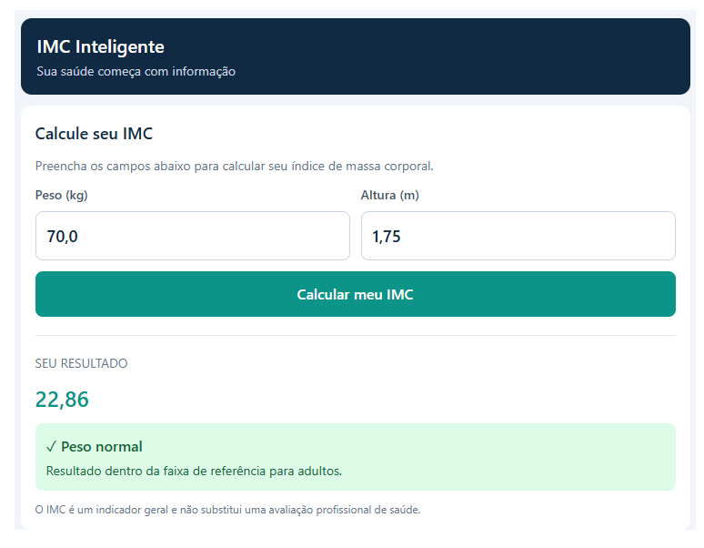

Dados:

**1. Interface (2 pontos)**

Apresentar o título “IMC Inteligente”.

Possuir campos para informar peso em quilogramas e altura em metros.

Utilizar elementos visuais do Streamlit, como títulos, colunas, cartões ou mensagens.

**2. Cálculo do IMC (2 pontos)**

Calcular o IMC utilizando a fórmula:

IMC = peso / (altura × altura)

Apresentar o resultado com duas casas decimais.

**3. Lógica de classificação (2,0 pontos)**

Utilizar estruturas condicionais if, elif e else para classificar o resultado conforme os intervalos para adultos:

- IMC menor que 18,5: abaixo do peso.

- IMC de 18,5 até menor que 25: peso normal.

- IMC de 25 até menor que 30: sobrepeso.

- IMC igual ou superior a 30: obesidade.

**4. Validação dos dados (2 pontos)**

A aplicação deverá impedir cálculos quando:

O peso for igual ou inferior a zero.

A altura for igual ou inferior a zero.

Nessas situações, deverá apresentar uma mensagem de erro apropriada.